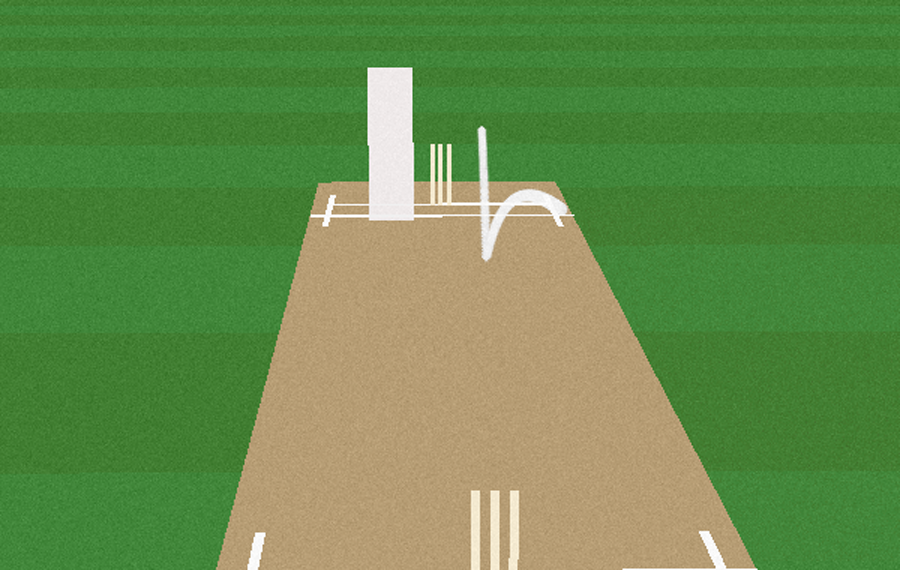

# Ball Tracker

Track a cricket ball in video from one phone on a tripod, rebuild its 3D path with a fitted
physics model, and predict where it would have crossed the stumps line: a single-camera
take on ball tracking for leg-before-wicket (LBW) reviews.

Broadcast systems use several calibrated cameras. With one camera, depth is not visible:
from behind the bowler, a ball flying 20 m down the pitch moves only a few dozen pixels.
This project recovers depth from physics instead. Gravity fixes the vertical scale over
time, and the bounce has to land on the pitch plane at the moment the image path turns.



*One rendered delivery seen from behind the bowler, all frames overlaid (`balltracker demo --seed 1000`).*

## Pipeline

```
video (240 fps slow motion, phone behind the bowler's stumps)
  -> calibrate   camera pose from pitch landmarks clicked in one frame (SQPnP + LM);
                 intrinsics from checkerboard photos
  -> detect      median background, threshold at 5x robust noise, small round blobs
  -> track       link blobs across frames; constant-acceleration gating; bridge the bounce
  -> fit         11-parameter physics model to the 2D track (robust least squares)
  -> predict     speed, bounce point, stumps-plane crossing, hitting or missing
```

## Physics model

State at the first tracked frame (3D position and velocity) plus five ball and pitch
parameters:

| Parameter | Meaning |
|---|---|
| drag | quadratic air drag, a = -k \|v\| v |
| swing | constant sideways acceleration before the bounce |
| restitution | vertical speed kept (and reversed) at the bounce |
| retention | along-ground speed kept through the bounce |
| seam | sideways speed added at the bounce |

Integration is RK4 at 1 ms, vectorized over a batch of parameter sets, so a fit's
multi-start search and finite-difference Jacobian each cost one batched simulation. The
bounce is located inside the step by interpolation plus one Newton correction. The
integrator matches SciPy's adaptive solver (rtol 1e-11) to within 1e-7 m.

## Fitting (system identification)

The fit minimizes reprojection error in pixels with a soft-L1 loss (a few bad detections
cannot drag it), plus weak Gaussian priors on the five ball parameters so it stays physical
when a clip barely constrains them. Starts come from a batched search: the first position
somewhere along its camera ray, aimed at a point along the last ray, at the speed that
covers that distance in the observed time. The best four starts are refined with bounded
trust-region least squares.

For an LBW call the ball is only seen until it reaches the pad. The evaluation fits only the
frames before x = 17.5 m (about 2.6 m in front of the stumps) and predicts the rest.

## How it is evaluated

Real footage does not come with the ball's true 3D path, so the benchmark renders
deliveries with exact ground truth: outfield, pitch, creases and stumps ray-cast from the
camera; a bowler who runs in and peels away; a batter who can hide the ball; a 1 ms
motion-blurred white or red ball; exposure flicker and sensor noise. Deliveries vary speed
(95–145 km/h), line, length, drag, swing, bounce and seam. Cameras vary position, height
and zoom.

The camera pose is **not** taken from the truth. It is calibrated from pitch landmarks
"clicked" with 1.5 px Gaussian error, so a user's clicking error carries through to every
number.

## Results

On 150 rendered deliveries at 240 fps, with the camera calibrated from clicks with 1.5 px
error:

| | Median | p90 |
|---|---:|---:|
| Stumps-line prediction error, using only frames before the pad | 4.8 cm | 17.1 cm |
| Bounce point error | 5.8 cm | 17.2 cm |
| Speed error | 1.8 km/h | 14.3 km/h |
| Fit reprojection RMS | 0.49 px | 0.85 px |

- Hitting or missing called correctly in 96.6% of the 148 deliveries fitted (2 of 150 had
  too short a track).
- Ball found in 91.4% of the frames where it was visible: 99.7% for a red ball but 87.7%
  for a white ball, which gets lost against the batter's white clothing. Every one of the
  eight worst cases is a white ball.

What the ablations show (same 60 deliveries, one change each):

- **Model terms matter most.** Without drag the median stumps error rises from 5.1 to
  9.2 cm. Without swing and seam it is 8.8 cm, with a p90 of 34 cm, and hit/miss accuracy
  falls from 96.6% to 89.8%.
- **Frame rate matters less than expected.** 60 to 240 fps all give about 5 cm. At 30 fps
  the error is 6.7 cm and 6 of 60 deliveries have too few points to fit.
- **Click error mostly moves the bounce point.** With perfect calibration the stumps error
  is 4.9 cm (from 5.1). With 3 px click error the bounce point error rises from 5.7 to
  9.2 cm.

Full tables, ablations and the worst cases: [docs/results.md](docs/results.md).

## Using it on real video

1. **Intrinsics, once per phone and zoom setting.** Photograph a printed checkerboard from
   10 to 15 angles, then run
   `balltracker calibrate-intrinsics photos/*.jpg --pattern 9x6 --square 0.024`.
2. **Record.** Tripod behind the bowler's stumps, as high as practical, slow motion (240 fps
   if the phone has it), zoomed so the pitch fills the frame.
3. **Click landmarks** in one frame and save them as JSON, using names from
   `balltracker.pitch.landmarks()`:
   ```json
   {"batter_stump_off_base": [652.1, 301.4], "batter_crease_left": [598.0, 318.2], ...}
   ```
4. **Track:**
   `balltracker track clip.mp4 --clicks clicks.json --intrinsics intrinsics.json --start 120 --stop 330`
   writes `result.json` (speed, bounce point, stumps crossing, hitting) and `overlay.png`.

## Commands

```bash
pip install -e ".[dev]"
balltracker demo --seed 1000          # render one delivery as video, plus its result
balltracker bench                      # full benchmark -> docs/results.md
pytest
```

## Layout

```
src/balltracker/
  pitch.py physics.py            world frame, pitch geometry, batched ball flight
  camera.py calibrate_scene.py   pinhole + distortion, PnP pose, checkerboard intrinsics
  scenario.py render.py          random deliveries and cameras, synthetic video with truth
  detect.py track.py             background subtraction, track linking
  fit.py predict.py              system identification, stumps prediction
  evaluate.py bench.py report.py end-to-end scoring and ablations
  video.py cli.py                real video and command line
```

## Limits

- Results are on rendered video. The real-video path runs end to end (a test feeds it a
  saved video file), but no real footage with known ground truth has been scored yet.
- One camera: depth along the line of sight is the weakest direction. Early-flight 3D error
  is larger than the error where it matters, after the bounce.
- The pitch is assumed flat, and spin is modelled only as its sideways effect (swing before
  the bounce, seam at the bounce).
